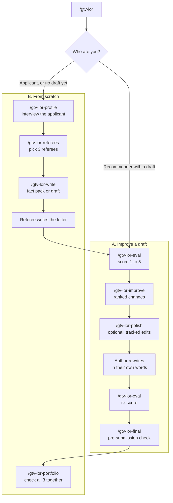

# gtv-lor

**Score, improve and write recommendation letters for the UK Global Talent visa (digital technology, Tech Nation).**

gtv-lor is a set of AI assistant skills. Give it a letter and it checks it against the official GOV.UK and Tech Nation rules, scores it out of 5, tells you exactly what to change, and can mark those changes up in your Word file. Starting from nothing? It interviews you and prepares what each referee needs.

Works in **Claude**, **ChatGPT**, **Claude Code** and any other AI assistant.

> [!IMPORTANT]
> Tech Nation's guide says letters created with AI tools are **not acceptable**, that templated letters may be treated as fraudulent, and that it may **contact referees**. gtv-lor gives feedback and facts; anything it writes for a letter is a suggestion the author must read, rewrite in their own words and own.

---

## Contents

- [Quick start](#quick-start)
- [Which workflow is mine?](#which-workflow-is-mine)
- [Commands](#commands)
- [What you get](#what-you-get)
- [Set up in detail](#set-up-in-detail)
- [What it checks](#what-it-checks)
- [Privacy](#privacy)
- [FAQ](#faq)
- [For maintainers](#for-maintainers)

---

## Quick start

Pick the assistant you already use:

| You use | Do this | Time |
|---------|---------|------|
| **Claude** (claude.ai, desktop or mobile) | Upload [gtv-lor.zip](https://github.com/j16h/gtv-lor/raw/main/downloads/claude-ai/gtv-lor.zip) as a skill ([steps](#claude)) | 2 min |
| **ChatGPT** | Open the shared GPT link from whoever sent you here, or build it from [the kit](#chatgpt) | 1 to 10 min |
| **Any other assistant** | Attach [gtv-lor-prompt.md](https://github.com/j16h/gtv-lor/raw/main/downloads/portable/gtv-lor-prompt.md) to a chat ([steps](#any-other-assistant)) | 1 min |
| **Claude Code** | `git clone https://github.com/j16h/gtv-lor.git && ./gtv-lor/install.sh` | 1 min |

Then start a chat, attach your letter, and type:

```
/gtv-lor
```

It asks who you are, takes your document and tells you what to run next.

---

## Which workflow is mine?



**A. You're a recommender with a draft letter**

1. `/gtv-lor`: say "I'm a recommender with a draft", give the route and the applicant's passport name, attach your letter (a .docx is best) and any fact pack the applicant sent.
2. `/gtv-lor-eval`: get a score out of 5, the rules it passes or fails, and the biggest gaps.
3. `/gtv-lor-improve`: get the changes ranked by impact, plus a fact pack of what to add. It asks for missing facts rather than guessing.
4. Rewrite in your own words, or run `/gtv-lor-polish` to see the changes as tracked edits in your .docx, then rewrite the highlighted parts.
5. `/gtv-lor-eval` again, then sign (DocuSign or similar), put your CV in the same PDF, and run `/gtv-lor-final`.

**B. You're the applicant, or nobody has a draft yet**

1. `/gtv-lor`: say "I'm the applicant".
2. `/gtv-lor-profile`: a short interview about your route, criteria, achievements, recognition and UK plans. Attach your CV to save time.
3. `/gtv-lor-referees`: list who you're considering; it vets each one and gives each letter a different main example.
4. `/gtv-lor-write`: for each referee, a fact pack (recommended) or a draft for them to rewrite.
5. When the letters come back, each goes through workflow A; then `/gtv-lor-portfolio` checks the three as a set.

---

## Commands

| Command | What it does | Workflow |
|---------|--------------|:--------:|
| `/gtv-lor` | Start here: asks your role, takes your document, shows progress | A, B |
| `/gtv-lor-eval` | Scores a letter 1 to 5 with a quote behind every score | A |
| `/gtv-lor-improve` | Ranked changes, the rule behind each, and a fact pack | A |
| `/gtv-lor-polish` | Your .docx with the changes as tracked edits, new text highlighted, a reason on each | A |
| `/gtv-lor-final` | Pre-submission checklist for every letter and the set | A |
| `/gtv-lor-profile` | Interviews the applicant and records their facts | B |
| `/gtv-lor-referees` | Vets referees and assigns each a distinct main example | B |
| `/gtv-lor-write` | A fact pack or a draft for one referee | B |
| `/gtv-lor-portfolio` | Checks the 3 letters together: overlap, coverage, consistency | B |

In ChatGPT and other assistants you can also just type the word, for example "eval" or "polish".

---

## What you get

**A score** (`/gtv-lor-eval`):

```
Overall: 3.5 / 5, Good: minor fixes   (route: Exceptional Talent)
Gates: 9 pass, 1 fail (G9: author's CV must be inside the same PDF)

| Dimension                          | Score | Evidence                                    |
| D2 Achievements (counts double)    | 4     | "led the rebuild ... from 40k to 2M users"  |
| D3 Leadership and recognition (x2) | 4     | "invited to keynote ... 3,000 attendees"    |
| D5 Contribution to UK tech         | 2     | "the UK is a great place for tech"          |
...
Biggest gaps
1. Attach your CV in the same PDF and sign via DocuSign (G9)
2. Name the UK institutions you have in mind (D4)
```

**A polished Word file** (`/gtv-lor-polish`): a copy of your letter where every suggestion is a tracked change. New text is highlighted yellow, removed text is struck through, and a margin comment explains each one ("Rule: Tech Nation says MSc thesis research does not qualify..."). Your original is never touched. In Word, use Review, Accept or Reject.

**A fact pack** (`/gtv-lor-improve`, `/gtv-lor-write`): the facts, numbers and rule points the author needs, with no sample sentences, so the letter stays in their words.

---

## Set up in detail

### Claude

1. Download [gtv-lor.zip](https://github.com/j16h/gtv-lor/raw/main/downloads/claude-ai/gtv-lor.zip). Don't unzip it.
2. In Claude, open **Settings, Capabilities** and turn on **Code execution and file creation**.
3. On the same page, under **Skills**, click **Upload skill** and choose `gtv-lor.zip`.
4. Start a new chat, attach your letter and type `/gtv-lor`, or just say "score my Global Talent recommendation letter".

This one skill contains every command.

### ChatGPT

One person with ChatGPT Plus builds the GPT once and shares the link. Anyone with the link can use it, including free users (with usage limits).

1. Download [chatgpt-gpt-kit.zip](https://github.com/j16h/gtv-lor/raw/main/downloads/chatgpt-gpt-kit.zip) and unzip it.
2. In ChatGPT, open **Explore GPTs, Create, Configure**.
3. Copy the name, description and conversation starters from `gpt-settings.md`, paste all of `instructions.md` into **Instructions**, and upload every file in `knowledge/`.
4. Turn on **Code Interpreter & Data Analysis**. It's needed for the checks and the polished .docx.
5. Save as **Anyone with the link** and share the link with your recommenders.

### Any other assistant

Works in Gemini, Copilot, or Claude and ChatGPT without any setup.

1. Download [gtv-lor-prompt.md](https://github.com/j16h/gtv-lor/raw/main/downloads/portable/gtv-lor-prompt.md).
2. Start a new chat, attach it and your letter, and write: *"Follow the instructions in gtv-lor-prompt.md. I'm a recommender with a draft letter."*

Without code execution it checks by reading, and gives polish suggestions as a table (current text, suggested text, reason) instead of a .docx.

### Claude Code

```bash
git clone https://github.com/j16h/gtv-lor.git
./gtv-lor/install.sh              # all commands
./gtv-lor/install.sh recommender  # or only workflow A
```

Restart Claude Code and type `/gtv-lor`. Progress is saved in a `gtv-lor-workspace/` folder in the directory you work in, so you can stop and pick up later.

### Picking up later

| Where | How |
|-------|-----|
| Claude Code | Type `/gtv-lor` in the same folder; it reads `gtv-lor-workspace/` |
| Claude, ChatGPT, others | Nothing is saved between chats. Each step offers its files as downloads; attach them to the new chat and type `/gtv-lor` |

---

## What it checks

Rules come from [GOV.UK](https://www.gov.uk/global-talent-digital-technology/documents-you-need-to-apply-endorsement) and the [Tech Nation guide](https://technation-globaltalentvisa-guide.notion.site/), retrieved 2026-10-30. Check both before you rely on them; they change.

**Pass or fail (any fail caps the score at 2):** the author is an established expert in digital technology, has known the applicant's work for 12+ months, wrote it for this application; the letter is dated, signed, up to 3 A4 sides, has phone and email, and comes with the author's CV in the same file.

**Scored 1 to 5:**

| Dimension | Weight |
|-----------|:------:|
| Author credibility and relationship | 1.5 |
| Achievements in digital technology | 2 |
| Leadership and recognition | 2 |
| Benefit to the applicant of living in the UK | 1 |
| Contribution to UK digital technology | 1 |
| Future plans | 1 |
| Sounds like the author (no templates, stock phrases or em-dashes) | 1.5 |
| Claims match the evidence | 1 |

**Across the 3 letters:** different main examples, the chosen criteria covered, independent authors, consistent facts, little shared wording.

---

## Privacy

- Letters and profiles contain personal data. In Claude Code they stay in `gtv-lor-workspace/` on your machine; add it to `.gitignore` and never push it to a public repository.
- In Claude, ChatGPT and other assistants, your files go to that provider under your account's terms.
- gtv-lor never sends anything anywhere else.

---

## FAQ

**Will it write the letter for me?**
It can produce a draft, but the safer path is a fact pack the author writes from. Tech Nation says AI-created letters are not acceptable and contacts referees, so any draft or polish is a starting point the author must rewrite and own.

**Does it need a .docx?**
Only `/gtv-lor-polish` does, because it edits the Word file. Everything else accepts .docx, .pdf, .md, .txt or pasted text.

**Exceptional Talent or Exceptional Promise?**
Both. It asks at the start and checks the letter uses the right language for your route.

**Is this legal advice?**
No. It checks letters against published guidance. For your circumstances, speak to an immigration adviser.

---

## For maintainers

```
skills/<name>/SKILL.md    one folder per command, self-contained (Claude Code)
shared/references/        rules, rubric, interview, drafting, workspace: the source of truth
shared/scripts/           letter_check.py, polish_docx.py (Python stdlib; pdftotext for PDFs)
platforms/                Claude.ai bundle skill, ChatGPT instructions, portable header
downloads/                generated: Claude.ai zip, ChatGPT kit, portable prompt
bin/sync.py               copies shared/ into each skill, builds dist/ and downloads/
install.sh                links the skills into ~/.claude/skills
```

1. Edit `shared/`, `skills/` or `platforms/`.
2. Run `python3 bin/sync.py`.
3. Commit, including `downloads/`. `python3 bin/sync.py --check` fails if any skill copy is stale.

---

Not legal or immigration advice.
