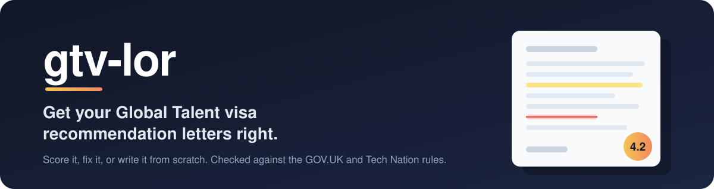
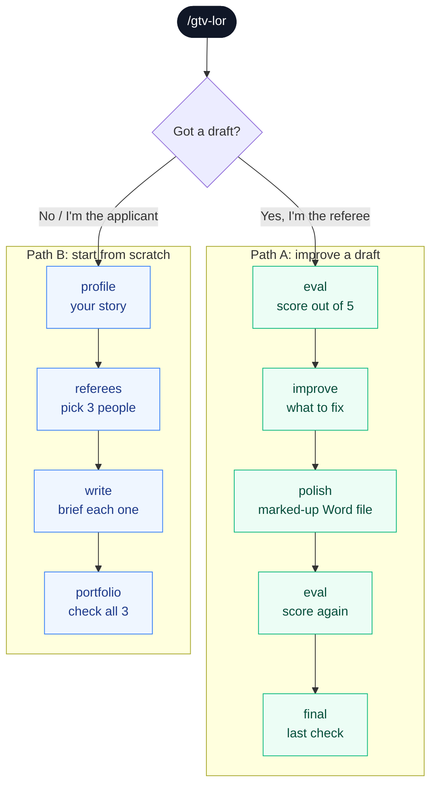
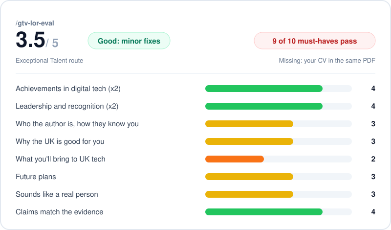
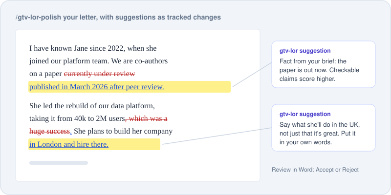

<p align="center">
  
</p>

<p align="center">
  <a href="#-install"></a>
  <a href="#-install"></a>
  <a href="#-install"></a>
  <a href="#-install"></a>
  <a href="#-what-it-checks"></a>
</p>

<p align="center">
  <a href="#-install"><b>Install</b></a> &nbsp;&nbsp;
  <a href="#-how-it-works"><b>How it works</b></a> &nbsp;&nbsp;
  <a href="#-skills"><b>Skills</b></a> &nbsp;&nbsp;
  <a href="#-what-you-get"><b>What you get</b></a> &nbsp;&nbsp;
  <a href="#-faq"><b>FAQ</b></a>
</p>

---

Writing (or asking for) a recommendation letter for the **UK Global Talent visa** is fiddly. There are rules about who can write it, what it has to say and how it has to look, and it's easy to miss one.

**gtv-lor** is a set of AI skills that reads a letter, checks it against the official GOV.UK and Tech Nation rules, scores it out of 5 and tells you what to fix. No letter yet? It interviews you and puts together what each referee needs to write a great one.

> [!IMPORTANT]
> **Coach, not ghostwriter.** Tech Nation doesn't accept letters written by AI, and they do contact referees to check. gtv-lor shows you what's missing and what to fix, but the words in the letter should be the author's own.

## 🚀 Install

Pick the assistant you already use. Each one has a **one-line prompt** you can paste so your AI walks you through it (or does it for you).

| | You use | Setup | Time |
|:-:|---------|-------|:----:|
| 🟠 | **Claude** (web, desktop, mobile) | Upload one zip as a skill | 2 min |
| 🟢 | **ChatGPT** | Open a shared GPT link, or build the GPT once | 1 to 10 min |
| ⬛ | **Claude Code** | One terminal command | 1 min |
| ⬛ | **Codex** | One terminal command | 1 min |
| ⚪ | **Anything else** (Gemini, Copilot...) | Attach one file to a chat | 1 min |

<details>
<summary><b>🟠 Claude</b> (claude.ai, desktop or mobile app)</summary>

<br>

**Let Claude walk you through it.** Paste this into a Claude chat:

```text
Help me install the gtv-lor skill. Read https://raw.githubusercontent.com/j16h/gtv-lor/main/INSTALL.md and walk me through the Claude steps one at a time.
```

**Or do it yourself:**

1. Download **[gtv-lor.zip](https://github.com/j16h/gtv-lor/raw/main/downloads/claude-ai/gtv-lor.zip)** and leave it zipped.
2. Go to **Settings → Capabilities** and switch on **Code execution and file creation**.
3. Under **Skills**, click **Upload skill** and pick the zip.
4. Start a new chat, attach your letter and type `/gtv-lor`.

One upload gives you all 9 skills.

</details>

<details>
<summary><b>🟢 ChatGPT</b> (Custom GPT)</summary>

<br>

💡 **Got a link?** If someone sent you a link to the gtv-lor GPT, just open it. You're done.

**Let ChatGPT walk you through building it** (needs ChatGPT Plus or higher). Paste this into a chat:

```text
Help me set up the gtv-lor GPT. Read https://raw.githubusercontent.com/j16h/gtv-lor/main/INSTALL.md and walk me through the ChatGPT steps one at a time.
```

**Or do it yourself:**

1. Download and unzip **[chatgpt-gpt-kit.zip](https://github.com/j16h/gtv-lor/raw/main/downloads/chatgpt-gpt-kit.zip)**.
2. Go to **Explore GPTs → Create → Configure**.
3. Copy the name, description and starters from `gpt-settings.md`, and paste all of `instructions.md` into **Instructions**.
4. Under **Knowledge**, upload everything in `knowledge/`.
5. Switch on **Code Interpreter & Data Analysis**.
6. Save as **Anyone with the link** and share it with your referees. Free accounts can use it too.

</details>

<details>
<summary><b>⬛ Claude Code</b></summary>

<br>

**Let Claude Code install it.** Paste this:

```text
Install the gtv-lor skills by following https://raw.githubusercontent.com/j16h/gtv-lor/main/INSTALL.md (Claude Code section).
```

**Or run it yourself:**

```bash
git clone https://github.com/j16h/gtv-lor.git ~/.gtv-lor
~/.gtv-lor/install.sh              # everything
~/.gtv-lor/install.sh recommender  # or just the referee path
```

Restart Claude Code and type `/gtv-lor`. Progress is saved in a `gtv-lor-workspace/` folder, so you can stop and come back.

</details>

<details>
<summary><b>⬛ Codex</b></summary>

<br>

**Let Codex install it.** Paste this:

```text
Install the gtv-lor skills by following https://raw.githubusercontent.com/j16h/gtv-lor/main/INSTALL.md (Codex section).
```

**Or run it yourself:**

```bash
git clone https://github.com/j16h/gtv-lor.git ~/.gtv-lor
~/.gtv-lor/install.sh codex              # everything
~/.gtv-lor/install.sh codex recommender  # or just the referee path
```

Restart Codex and type `$gtv-lor`, or just ask for help with your Global Talent letter.

</details>

<details>
<summary><b>⚪ Anything else</b> (Gemini, Copilot, or Claude and ChatGPT with no setup)</summary>

<br>

1. Download **[gtv-lor-prompt.md](https://github.com/j16h/gtv-lor/raw/main/downloads/portable/gtv-lor-prompt.md)**.
2. Attach it to a new chat along with your letter, and say:

```text
Follow the instructions in gtv-lor-prompt.md. I'm a referee with a draft letter.
```

If the assistant can't run code, it checks by reading and gives suggestions as a table instead of a marked-up Word file.

</details>

## 🧭 How it works

Start with `/gtv-lor`. It asks who you are and puts you on one of two paths.



<table>
<tr>
<th width="50%">✍️ Path A: you've written a letter</th>
<th width="50%">🌱 Path B: you're the applicant, or there's no draft</th>
</tr>
<tr>
<td valign="top">

1. **`/gtv-lor`** Attach your letter (Word is best) and anything the applicant sent you.
2. **`/gtv-lor-eval`** Score out of 5, which rules pass, the biggest gaps.
3. **`/gtv-lor-improve`** What to change, most important first. It asks for missing facts instead of making them up.
4. **`/gtv-lor-polish`** *(optional)* Your Word file back with suggestions marked up. Rewrite them in your words.
5. **`/gtv-lor-eval`** again, then sign, add your CV to the PDF and run **`/gtv-lor-final`**.

</td>
<td valign="top">

1. **`/gtv-lor`** Say you're the applicant.
2. **`/gtv-lor-profile`** A few questions at a time about your route, wins and UK plans. Attach your CV to speed it up.
3. **`/gtv-lor-referees`** Pick 3 people and give each something different to talk about.
4. **`/gtv-lor-write`** A brief for each referee: facts and rules, ready to send.
5. When letters come back, run each through path A, then **`/gtv-lor-portfolio`**.

</td>
</tr>
</table>

## 🧰 Skills

gtv-lor is 9 skills that work together. Run one by typing its name: `/gtv-lor-eval` in Claude and Claude Code, `$gtv-lor-eval` in Codex. You can also just ask ("score my letter") and the right skill kicks in.

| Skill | What it does | Path |
|---------|--------------|:----:|
| `/gtv-lor` | Start here. Asks who you are, takes your letter, shows where you're at | A B |
| `/gtv-lor-eval` | Scores a letter out of 5, quoting the bits behind each score | A |
| `/gtv-lor-improve` | What to change and why, most important first | A |
| `/gtv-lor-polish` | Marks up your Word file with suggestions to accept or reject | A |
| `/gtv-lor-final` | One last check before you submit | A |
| `/gtv-lor-profile` | Gets the applicant's story down: wins, numbers, UK plans | B |
| `/gtv-lor-referees` | Helps choose referees and splits the topics between them | B |
| `/gtv-lor-write` | A brief for one referee (or a rough draft they rewrite) | B |
| `/gtv-lor-portfolio` | Checks all 3 letters side by side | B |

> [!NOTE]
> In ChatGPT and other assistants all 9 skills live in one GPT or file, so you can just type the word, like "eval" or "polish".

## 🎁 What you get

### A score you can act on

`/gtv-lor-eval` scores 8 things, each backed by a quote from the letter, and flags any must-have you're missing.

<p align="center"></p>

### Your letter, marked up

`/gtv-lor-polish` hands back your Word file with every suggestion as a tracked change: new text highlighted, old text crossed out, and a comment saying why. Your original stays untouched.

<p align="center"></p>

### A brief for each referee

`/gtv-lor-improve` and `/gtv-lor-write` give the author the facts, numbers and rules they need, with no ready-made sentences, so the letter ends up in their voice.

## ✅ What it checks

Everything comes from the [GOV.UK page](https://www.gov.uk/global-talent-digital-technology/documents-you-need-to-apply-endorsement) and [Tech Nation's guide](https://technation-globaltalentvisa-guide.notion.site/), as of **30 October 2026**. They do change, so give them a look before you submit.

<details>
<summary><b>The must-haves</b> (miss one and the score can't go above 2)</summary>

<br>

- [ ] The author is an established expert in digital tech
- [ ] They've known the applicant's work for at least 12 months
- [ ] It's written for this application
- [ ] It's dated and signed
- [ ] It's no longer than 3 A4 pages
- [ ] It has the author's phone and email
- [ ] The author's CV is in the same file

</details>

<details>
<summary><b>The 8 things it scores</b> (each out of 5)</summary>

<br>

| What | Weight |
|------|:------:|
| Achievements in digital tech | ×2 |
| Leadership and recognition | ×2 |
| Who the author is and how they know the applicant | ×1.5 |
| Sounds like a real person (no templates, clichés or em-dashes) | ×1.5 |
| Why the UK is good for the applicant | ×1 |
| What the applicant will bring to UK tech | ×1 |
| Future plans | ×1 |
| Claims match the evidence | ×1 |

| Score | Verdict |
|:-----:|---------|
| 4.5 to 5 | 🟢 Strong: send it |
| 3.5 to 4.4 | 🟡 Good: minor fixes |
| 2.5 to 3.4 | 🟠 Needs work |
| below 2.5 | 🔴 Not usable yet |

</details>

<details>
<summary><b>Across all 3 letters</b></summary>

<br>

- Each letter has its own main story
- Together they cover the criteria you're applying under
- The authors aren't all your close colleagues
- Names, dates and numbers line up
- They don't share wording

</details>

## 🔒 Your data

- **Claude Code and Codex:** everything stays in `gtv-lor-workspace/` on your computer. Add it to `.gitignore` and never push it anywhere public.
- **Claude, ChatGPT and others:** your files are handled by that provider under your account's terms. Chats don't remember each other, so save the files it gives you and attach them next time.
- gtv-lor doesn't send anything anywhere else.

## 💬 FAQ

<details>
<summary><b>Can it just write the letter for me?</b></summary>

<br>

It can do a rough draft, but we'd steer you toward the brief instead. Tech Nation doesn't accept AI-written letters and does check with referees, so whatever it drafts, the author needs to rewrite in their own words.

</details>

<details>
<summary><b>Do I need a Word file?</b></summary>

<br>

Only for `/gtv-lor-polish`, since that's the one that edits the file. Everything else is happy with Word, PDF, text or a paste.

</details>

<details>
<summary><b>Exceptional Talent or Exceptional Promise?</b></summary>

<br>

Either. It asks at the start and checks the letter talks about the applicant the right way for their route.

</details>

<details>
<summary><b>How do I pick up where I left off?</b></summary>

<br>

In Claude Code or Codex, run `/gtv-lor` (or `$gtv-lor`) in the same folder. Anywhere else, attach the files it gave you last time and run `/gtv-lor`.

</details>

<details>
<summary><b>Is this legal advice?</b></summary>

<br>

Nope. It checks letters against the published guidance. If your situation is tricky, talk to an immigration adviser.

</details>

## 🛠️ For maintainers

<details>
<summary><b>Repo layout and how to update</b></summary>

<br>

```text
skills/<name>/SKILL.md    one folder per skill, each works on its own
shared/references/        rules, rubric, interview, drafting, workspace: edit these
shared/scripts/           letter_check.py, polish_docx.py (plain Python; pdftotext for PDFs)
platforms/                Claude.ai bundle, ChatGPT instructions, portable header
downloads/                generated: Claude.ai zip, ChatGPT kit, portable prompt
assets/                   README images
bin/sync.py               copies shared/ into each skill, rebuilds dist/ and downloads/
install.sh                links the skills into Claude Code or Codex
INSTALL.md                install steps written for AI agents
```

1. Edit `shared/`, `skills/` or `platforms/`.
2. Run `python3 bin/sync.py`.
3. Commit everything, `downloads/` included. `python3 bin/sync.py --check` tells you if anything's out of date or a skill's frontmatter is invalid.

</details>

---

<p align="center"><sub>Not legal or immigration advice. Built to help, not to replace your judgement.</sub></p>
